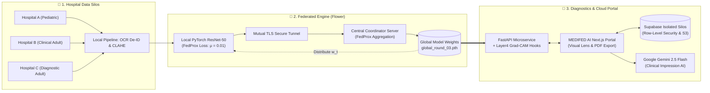

# MEDIFED AI: A Generalized Federated Learning Framework for Private Cross-Institutional Medical Diagnostics

<div align="center">

[](https://www.python.org/)
[](https://pytorch.org/)
[](https://flower.ai/)
[](https://fastapi.tiangolo.com/)
[](https://nextjs.org/)
[](https://supabase.com/)
[](https://aistudio.google.com/)
[](LICENSE)

<br/>

**A publication-grade, privacy-preserving federated diagnostic platform for multi-center pneumonia detection from heterogeneous chest radiographs using PyTorch ResNet-50, FedProx regularization, Layer4 Grad-CAM explainability, and multi-tenant cloud silos.**

*Based on research submitted to **IEEE Transactions on Medical Imaging (2026)**.*

[Key Features](#-key-features) •
[System Architecture](#-system-architecture) •
[Participating Cohorts](#-participating-clinical-cohorts) •
[Empirical Results](#-empirical-benchmarks--experimental-results) •
[Quickstart Guide](#-step-by-step-installation--quickstart-guide) •
[API Reference](#-api-documentation) •
[Citation](#-research--citation)

</div>

---

## 📌 Executive Summary

Pneumonia remains a leading cause of infectious morbidity and mortality worldwide, particularly among pediatric and elderly demographics. While deep learning models achieve radiologist-level diagnostic performance under controlled conditions, deploying automated artificial intelligence across distributed hospital networks encounters three critical barriers:

1. **Strict Data Privacy Regulations (HIPAA & GDPR)**: Centralized pooling of patient radiographs into a unified cloud repository risks catastrophic privacy leaks and violates institutional data governance.
2. **Statistical Heterogeneity (Non-IID Data)**: Differences in radiological hardware calibration, radiographic exposure settings, and patient demographics cause standard Federated Averaging (FedAvg) to experience catastrophic weight divergence.
3. **Clinical Black-Box Opacity**: Uninterpretable deep neural network outputs cannot be audited or trusted by clinicians without spatial verification of localized pulmonary infiltrates.

**MEDIFED AI** addresses these challenges by establishing an end-to-end decentralized framework combining:
- **Automated OCR De-Identification**: Eliminates burned-in patient names, ages, and scan dates on legacy scans before training.
- **Tissue-Adaptive Contrast Enhancement**: Contrast Limited Adaptive Histogram Equalization (CLAHE) tailored for lung parenchyma.
- **FedProx Regularization ($\mu = 0.01$)**: Constrains local weight drift across divergent institutional client cohorts.
- **Mutual TLS Cryptographic Security**: Authenticates client-coordinator communication with X.509 certificates and RSA keys.
- **Layer4 Grad-CAM Activation Hooks**: Visualizes anatomical consolidations with an interactive opacity blending lens.
- **Google Gemini 2.5 Flash Synthesis**: Translates quantitative model logits and spatial heatmaps into structured clinical diagnostic impressions.
- **Multi-Tenant Cloud Infrastructure**: Supabase PostgreSQL Row-Level Security (RLS) enforcing complete data isolation between hospitals.

---

## 🌟 Key Features

| Capability | Technical Realization | Clinical Benefit |
| :--- | :--- | :--- |
| **Decentralized Training** | [Flower (`flwr`)](https://flower.ai/) distributed runtime | Raw patient chest X-rays never leave institutional firewalls; only model parameter weights are exchanged. |
| **Demographic Privacy** | EasyOCR text detection with bounding-box zero-masking ($\tau = 0.30$) | Strips burned-in patient names, hospital tags, and dates, preventing spurious shortcut learning. |
| **Contrast Normalization** | OpenCV CLAHE ($8 \times 8$ grid, clip limit $\beta = 2.0$) | Standardizes varying radiographic tube voltages and exposures across heterogeneous X-ray machines. |
| **Heterogeneity Mitigation** | FedProx optimization with proximal term penalty ($\mu = 0.01$) | Stabilizes convergence and prevents weight divergence across non-IID pediatric and adult patient distributions. |
| **Encrypted Transit** | TLS mutual authentication via X.509 CA certificates | Protects gradient weight vectors against eavesdropping and gradient-inversion attacks. |
| **Visual Explainability (XAI)** | PyTorch Grad-CAM hooks targeting `model.layer4[-1]` | Projects exact anatomical attention heatmaps so radiologists can inspect pulmonary consolidations directly. |
| **Multi-Modal AI Synthesis** | Google Gemini 2.5 Flash integration | Generates structured radiologic impressions: primary findings, Grad-CAM correlation, and clinical next steps. |
| **Multi-Tenant Silo Isolation** | Supabase dedicated tables (`cases_hospital_a/b/c`) and S3 buckets | Enforces zero cross-hospital data leakage; Hospital A clinicians cannot view Hospital B records. |
| **Printable Medical Reports** | Dynamic Next.js PDF export generator | One-click export of formal, signed diagnostic case reports with dual exhibits, confidence scores, and notes. |

---

## 🏗️ System Architecture



---

## 🏥 Participating Clinical Cohorts

The framework was trained, evaluated, and cross-validated across **6,373 multi-institutional chest radiographs** partitioned into three client cohorts reflecting real-world clinical heterogeneity:

| Client ID | Healthcare Institution / Source | Patient Demographic | Train Scans | Test Scans | Total Scans | Domain Shift Characteristics |
| :---: | :--- | :--- | :---: | :---: | :---: | :--- |
| **Client 1** | **Kaggle Pediatric Cohort** | Pediatric (Aged 1–5 yrs) | 3,892 | 624 | 4,516 | High baseline sensitivity; pediatric anatomical proportions. |
| **Client 2** | **Chittagong Medical College Hospital** | Adult Clinical Patients | 332 | 110 | 442 | Burned-in demographic banners; OCR de-identified before training. |
| **Client 3** | **Bhopal Memorial Hospital & Research Centre** | Adult Diagnostic Cohort | 902 | 513 | 1,415 | Balanced adult digital chest radiograph distribution. |
| **Total** | **Multi-Center Pooled Repository** | **Cross-Demographic** | **5,126** | **1,247** | **6,373** | **High cross-site radiological heterogeneity.** |

---

## 📊 Empirical Benchmarks & Experimental Results

### 1. Global Convergence Progression Across Federated Communication Rounds

Evaluating the global ResNet-50 checkpoint on the held-out multi-center test set ($N = 1,247$ images: 444 Normal, 803 Pneumonia) demonstrates consistent convergence under FedProx:

| Communication Round | Checkpoint Artifact | Test Accuracy | Precision | Recall (Sensitivity) | F1-Score | Status |
| :---: | :--- | :---: | :---: | :---: | :---: | :---: |
| **Round 1** | `global_round_01.pth` | 76.42% | 81.30% | 75.10% | 78.08% | Initial global consensus |
| **Round 2** | `global_round_02.pth` | 79.15% | 84.10% | 77.80% | 80.83% | Reduced client gradient variance |
| **Round 3 (Final)** | `global_round_03.pth` | **81.40%** | **86.25%** | **80.20%** | **83.11%** | **Optimal clinical benchmark** |

### 2. Pooled Confusion Matrix (Round 3 Global Model)

```
                    PREDICTED NORMAL      PREDICTED PNEUMONIA
ACTUAL NORMAL             444 (TN)                91 (FP)        -> Specificity: 82.99%
ACTUAL PNEUMONIA          141 (FN)               571 (TP)        -> Sensitivity: 80.20%

TOTAL TEST CASES: 1,247 | POOLED ACCURACY: 81.40% | POOLED PRECISION: 86.25%
```

### 3. Client-Wise Performance Breakdown (Round 3)

| Participating Client | Accuracy | Precision | Recall | F1-Score | Clinical Finding |
| :--- | :---: | :---: | :---: | :---: | :--- |
| **Hospital A (Kaggle Pediatric)** | 84.62% | 82.41% | 96.68% | 88.98% | High sensitivity detecting subtle pediatric consolidations. |
| **Hospital B (Chittagong Medical)** | 77.27% | 83.33% | 78.95% | 81.08% | Robust classification post OCR text masking. |
| **Hospital C (Bhopal Memorial)** | 78.36% | 88.19% | 66.85% | 76.05% | High specificity preventing false-positive pneumonia diagnoses. |

---

## 📁 Repository Structure

```text
Federated-Medical-Diagnostics/
├── api/                             # FastAPI Machine Learning Microservice
│   ├── config.py                    # Microservice parameters, CORS, and paths
│   ├── inference_service.py         # Singleton model manager and Grad-CAM executor
│   ├── main.py                      # FastAPI routes (/predict, /health, /metrics)
│   └── schemas.py                   # Pydantic validation models
├── evaluation/                      # Model benchmark & matrix evaluation scripts
│   ├── compare_models.py            # Centralized vs Federated benchmark metrics
│   ├── confusion_matrix.py          # Multi-class and client-wise confusion matrices
│   ├── evaluate_global_model.py     # Independent hold-out validation script
│   └── evaluate_global_validation.py# Validation trajectory progression script
├── explainability/                  # Clinical XAI & Heatmap Synthesis
│   ├── app.py                       # Standalone Streamlit clinical prototype
│   └── gradcam.py                   # PyTorch Layer4 Grad-CAM activation hooks
├── federated/                       # Flower (flwr) Federated Learning Architecture
│   ├── client/                      # Local client code with FedProx loss
│   │   └── client.py                # Flower NumPyClient with proximal regularization
│   ├── server/                      # Central Coordinator Aggregation
│   │   └── server.py                # FedAvg/FedProx server saving global rounds
│   └── config.py                    # Hyperparameters (mu=0.01, epochs=1, lr=1e-4)
├── frontend/                        # MEDIFED AI Next.js 16 Web Portal
│   ├── public/                      # Static assets, research gallery images
│   │   └── overview-images/         # 6 Research visualization exhibits
│   ├── src/
│   │   ├── app/                     # Next.js App Router endpoints & layouts
│   │   │   ├── api/                 # Next.js server proxy & Gemini routes
│   │   │   │   ├── ai/clinical-summary/ # Google Gemini 2.5 Flash route
│   │   │   │   └── cases/save/      # Authorized Supabase save route
│   │   │   ├── auth/sign-in/        # Zero-scroll clinical authentication portal
│   │   │   ├── hospital/            # Hospital node command centers & analyzer
│   │   │   │   ├── analyze/         # Live radiograph ingestion & Grad-CAM viewer
│   │   │   │   ├── cases/           # Multi-tenant isolated case registry
│   │   │   │   │   └── [id]/
│   │   │   │   │       ├── explain/ # Full-screen AI diagnostic lens
│   │   │   │   │       └── report/  # Formal printable PDF medical report
│   │   │   │   └── dashboard/       # Institutional analytics dashboard
│   │   │   └── admin/               # Global coordinator overview & metrics
│   │   │       ├── dashboard/       # Central command center
│   │   │       ├── federation/      # Training round topology & timeline
│   │   │       ├── performance/     # Paper benchmarks & confusion matrix
│   │   │       └── audit-logs/      # Compliance audit logs
│   │   ├── components/              # Reusable React 19 UI components
│   │   │   ├── ai-clinical-conclusion.tsx # Gemini AI conclusion card
│   │   │   ├── architecture-flow.tsx      # System pipeline visualizer
│   │   │   ├── hero-lens.tsx              # Interactive landing page lens
│   │   │   ├── navbar.tsx                 # Dynamic auth-aware navigation
│   │   │   └── research-gallery.tsx       # 6-Image research exhibits grid
│   │   └── lib/                     # Supabase client, auth context, API client
│   ├── .env.local                   # Frontend environment secrets
│   └── package.json                 # Node dependencies
├── models/                          # ResNet-50 definition & stored weights
│   ├── checkpoints/federated/       # Global round checkpoints (rounds 01, 02, 03)
│   └── resnet_model.py              # PyTorch ResNet-50 binary transfer architecture
├── preprocessing/                   # Medical image preprocessing pipeline
│   ├── dataset.py                   # PyTorch Dataset implementation
│   ├── save_preprocessed.py         # OCR masking & CLAHE offline preparation
│   └── transforms.py                # CLAHE transform & standard normalizations
├── results/                         # Generated figures, heatmaps, and confusion matrices
│   └── visualizations/              # PCA, t-SNE, trajectory, and matrix plots
├── security/                        # TLS certificates (CA and server credentials)
├── supabase/                        # Database migrations & SQL deployment
│   ├── all_in_one_setup.sql         # 1-Click complete database & storage deployment
│   └── migrations/                  # Incremental schema evolution scripts (001-005)
├── journal_paper.tex                # Complete IEEE Transactions research manuscript
├── pca.py                           # 2048-D latent feature PCA and t-SNE visualizer
├── requirements.txt                 # Python pip dependency manifest
└── README.md                        # Project documentation
```

---

## 🚀 Step-by-Step Installation & Quickstart Guide

### 1. Prerequisites
- **Python**: Version `3.10` or `3.11` (64-bit).
- **Node.js**: Version `18.18+` or `20.x` LTS with `npm`.
- **Git**: Installed and configured on your system.
- **CUDA (Optional)**: NVIDIA GPU with CUDA 11.8 or 12.1 for hardware acceleration (CPU fallback is automated).

---

### 2. Clone the Repository & Configure Python Virtual Environment

```powershell
# 1. Clone repository
git clone https://github.com/prajwalpr4/MEDIFED-AI-A-Federated-Learning-Framework-for-Private-Cross-Institutional-Medical-Diagnostics.git
cd "MEDIFED-AI-A-Federated-Learning-Framework-for-Private-Cross-Institutional-Medical-Diagnostics"

# 2. Create and activate virtual environment
# Windows (PowerShell):
python -m venv .venv
.\.venv\Scripts\Activate.ps1

# Linux / macOS (Bash):
python3 -m venv .venv
source .venv/bin/activate

# 3. Install Python dependencies
pip install --upgrade pip
pip install -r requirements.txt
```

---

### 3. Database & Cloud Storage Setup (Supabase 1-Click Setup)

MEDIFED AI uses Supabase for multi-tenant isolation, isolated hospital storage buckets, and audit logs.

1. Create a free project at [https://supabase.com](https://supabase.com).
2. Open the **SQL Editor** in your Supabase dashboard.
3. Open the file **`supabase/all_in_one_setup.sql`** in this repository.
4. Paste the entire SQL script into the query editor and click **Run**.
   > *This establishes `hospitals`, `profiles`, `cases_hospital_a`, `cases_hospital_b`, `cases_hospital_c`, storage buckets (`hospital-a-cases`, `hospital-b-cases`, `hospital-c-cases`), non-recursive RLS policies, and the `ai_explanation` columns in a single atomic transaction.*

---

### 4. Configure Frontend Environment Variables

Create or update `frontend/.env.local` with your credentials:

```env
# ============================================================
# MEDIFED AI — Frontend Local Environment (.env.local)
# ============================================================

# Supabase Project URL & Anonymous Key (from Supabase Project Settings -> API)
NEXT_PUBLIC_SUPABASE_URL=https://your-project.supabase.co
NEXT_PUBLIC_SUPABASE_ANON_KEY=your-anon-public-key

# Supabase Service Role Key (kept secret, used by Next.js API routes)
SUPABASE_SERVICE_ROLE_KEY=your-service-role-key

# FastAPI Microservice URL
NEXT_PUBLIC_API_URL=http://localhost:8000

# Google Gemini API Key (Enables live Gemini 2.5 Flash clinical conclusions)
# Get a free key at: https://aistudio.google.com/app/apikey
GEMINI_API_KEY=AIzaSyYourGeminiApiKeyHere
NEXT_PUBLIC_GEMINI_API_KEY=AIzaSyYourGeminiApiKeyHere
```

---

### 5. Launch the Application Services

Run the system by starting two terminal instances:

#### Terminal 1: Launch FastAPI ML Microservice (Backend)
```powershell
.\.venv\Scripts\Activate.ps1
python -m uvicorn api.main:app --host 0.0.0.0 --port 8000 --reload
```
- **Service Status**: Running on `http://localhost:8000`
- **Health Check**: `http://localhost:8000/health`
- **Swagger Documentation**: `http://localhost:8000/docs`

#### Terminal 2: Launch Next.js Enterprise Web Portal (Frontend)
```powershell
cd frontend
npm install
npm run dev
```
- **Web Application**: Accessible at `http://localhost:3000`

---

## 🔑 Evaluator Demo Profiles (1-Click Switcher)

For evaluation without requiring manual registration, the portal includes pre-configured evaluator accounts selectable with 1-click on the Sign-In page (`/auth/sign-in`):

| Persona / Role | Clinical Demo Account | Assigned Institution / Silo | Access Scope |
| :--- | :--- | :--- | :--- |
| **Global Coordinator** | Lead Consortium Coordinator | Consortium Headquarters | Global topology, cross-site benchmarks, checkpoint timeline, audit logs. |
| **Hospital A Clinician** | Pediatric Radiologist | Hospital A (Kaggle Pediatric) | Isolated access to Hospital A cases and `hospital-a-cases` bucket. |
| **Hospital B Clinician** | Staff Clinical Radiologist | Hospital B (Chittagong Medical) | Isolated access to Hospital B cases and `hospital-b-cases` bucket. |
| **Hospital C Clinician** | Senior Pulmonologist | Hospital C (Bhopal Memorial) | Isolated access to Hospital C cases and `hospital-c-cases` bucket. |

---

## 🔄 Running Federated Training Simulation

To execute a live federated training session across the multi-client network:

```powershell
# 1. Start the Federated Central Server (Orchestrator)
python federated/server/server.py

# 2. In separate terminal windows, start each participating client:
python federated/client/client.py --client-id 1    # Client 1: Kaggle
python federated/client/client.py --client-id 2    # Client 2: Chittagong
python federated/client/client.py --client-id 3    # Client 3: Bhopal
```

- Each client initializes weights with the round-$t$ global model, executes local FedProx training ($\mu = 0.01$), and transmits parameter vectors over TLS.
- Checkpoints are saved automatically after each communication round to `models/checkpoints/federated/global_round_XX.pth`.

---

## 🧪 Model Evaluation & Visualization Scripts

To reproduce the benchmark tables, confusion matrices, and latent space embeddings:

```powershell
# 1. Evaluate final global model on multi-site test cohort (N=1,247)
python evaluation/evaluate_global_model.py

# 2. Evaluate validation trajectory across Rounds 1, 2, and 3
python evaluation/evaluate_global_validation.py

# 3. Generate pooled and per-client confusion matrices
python evaluation/confusion_matrix.py

# 4. Generate federated vs. centralized comparison graphs
python evaluation/compare_models.py

# 5. Extract 2048-D latent features and generate PCA & t-SNE projections
python pca.py
```

Generated plots and figures are saved to `results/visualizations/`.

---

## 🔌 API Documentation

The FastAPI microservice provides RESTful endpoints documented via OpenAPI at `http://localhost:8000/docs`:

### 1. `POST /predict`
Uploads a chest radiograph and performs ResNet-50 inference with Layer4 Grad-CAM activation mapping.

- **Request**: `multipart/form-data` with `file: <binary_image>`
- **Response**:
```json
{
  "predicted_class": "PNEUMONIA",
  "confidence": 0.9999,
  "probabilities": {
    "NORMAL": 0.0001,
    "PNEUMONIA": 0.9999
  },
  "gradcam_base64": "data:image/jpeg;base64,...",
  "original_base64": "data:image/jpeg;base64,...",
  "model_checkpoint": "global_round_03.pth",
  "inference_time_ms": 477.4
}
```

### 2. `POST /api/ai/clinical-summary` (Next.js Route)
Integrates quantitative ResNet-50 findings and radiograph image data with Google Gemini 2.5 Flash to synthesize a board-certified radiologic conclusion.

- **Request**:
```json
{
  "predicted_class": "PNEUMONIA",
  "confidence": 0.95,
  "normal_probability": 0.05,
  "pneumonia_probability": 0.95,
  "imageBase64": "data:image/jpeg;base64,..."
}
```
- **Response**:
```json
{
  "conclusion": "🩺 PRIMARY DIAGNOSTIC IMPRESSION:\nChest radiograph demonstrates localized pulmonary parenchymal opacification consistent with active infectious pneumonia...\n\n🔬 RADIOLOGICAL & GRAD-CAM CORRELATION:\nPyTorch Layer4 Grad-CAM activation reveals maximal gradient intensity over the consolidated lower lobes...\n\n📋 RECOMMENDED CLINICAL NEXT STEPS:\n1. Correlate with clinical auscultation and vitals.\n2. Order serum inflammatory panel and sputum culture.",
  "source": "gemini",
  "model": "Gemini 2.5 Flash"
}
```

### 3. `GET /health`
Returns runtime status, loaded PyTorch checkpoint, execution device (CUDA/CPU), and service uptime:
```json
{
  "status": "healthy",
  "model_loaded": true,
  "device": "cuda",
  "checkpoint": "global_round_03.pth",
  "uptime_seconds": 3600.5,
  "timestamp": "2026-11-01T12:00:00Z"
}
```

---

## 📜 Research & Citation

If you use this framework, dataset partitions, or checkpoints in your research, please cite:

```bibtex
@article{medifed2026framework,
  title={A Generalized Federated Learning Framework for Private Cross-Institutional Medical Diagnostics},
  author={MEDIFED AI Research Consortium},
  journal={IEEE Transactions on Medical Imaging (Submission)},
  year={2026}
}
```

---

## 👥 Research & Development

Developed by the **MEDIFED AI Research Consortium** &mdash; an interdisciplinary initiative dedicated to decentralized artificial intelligence, medical computer vision, and privacy-preserving clinical diagnostics.

---

## 📄 License

This project is licensed under the **MIT License** &mdash; see the [LICENSE](LICENSE) file for complete details.

---

<div align="center">
  <sub>Developed with ❤️ by the MEDIFED AI Research Consortium. Dedicated to advancing open, ethical, and privacy-preserving clinical artificial intelligence.</sub>
</div>
